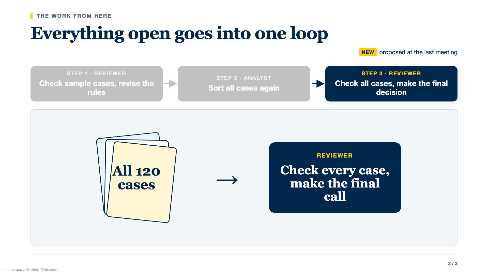

# TJ Slide Skill

A reusable AI skill for concise, speaker-led HTML slide decks with progressive reveals, strong visual hierarchy, and full click-state QA.

The central principle is simple:

> **The speaker carries the detail; the slide carries the shape.**



This skill is designed for short talks, lab meetings, research updates, and executive briefings—especially when the source draft has too many slides, too many words, status tables where a process should be, or content that should appear click by click as the speaker talks.

## What it does

- Builds the story before the HTML: one claim, one dominant visual, and one semantic unit per click.
- Turns status tables into visible processes, including skipped steps, review loops, and ownership.
- Uses progressive reveals: the active idea is saturated; completed ideas recede or leave.
- Keeps the deck offline and portable in a single HTML file.
- Includes speaker notes, keyboard navigation, fullscreen mode, and deep links to any slide/click state.
- Renders every click state and produces a labelled contact sheet for visual review.
- Flags overflow, tiny text, failed requests, external dependencies, and broken forward/back navigation.

## Default story pattern

For a five-to-ten-minute update, the default is usually three slides:

1. **Where we are and why** — show the process and its gaps.
2. **How the open work gets resolved** — one workflow with a check-and-loop-back path.
3. **Who does what next** — one card per person, plus one line for anything on hold.

The skill can use more or fewer slides when the argument requires it. It does not force every topic into this pattern.

## Repository structure

```text
SKILL.md                       Main agent instructions
assets/starter/deck.html       Dependency-free 16:9 HTML starter
references/                    Story, copy, visual, motion, intake, and QA guidance
scripts/verify_deck.mjs        Full click-state renderer and checker
agents/openai.yaml             Skill display metadata
```

## Install

Clone the repository into the skill-discovery directory used by your agent.

### Codex

```bash
git clone https://github.com/XiangluTANG111/tj-slide-skill.git ~/.codex/skills/tj-slide-skill
```

### Claude Code

```bash
git clone https://github.com/XiangluTANG111/tj-slide-skill.git ~/.claude/skills/tj-slide-skill
```

If your environment uses a workspace-level skill index, clone the repository into that indexed directory instead.

## Use

Example request:

```text
Use $tj-slide-skill to turn this project update into a five-minute HTML deck.
Preserve the claims and numbers, reduce the slide count, reveal one idea per click,
and validate every click state before handing it back.
```

The skill will:

1. Ask only for missing audience or delivery context.
2. Write a short deck plan.
3. Build from the starter.
4. Render and inspect every click state.
5. Report what was verified, assumed, and left for human judgment.

## Build from the starter

```bash
cp assets/starter/deck.html my-deck.html
```

Replace the three example slides while keeping the `SYSTEM` styles and the `ENGINE` block. The starter works offline and supports:

- `data-s="2"` — show from click 2
- `data-e="4"` — hide from click 4
- `data-dim="3"` — keep visible but recede from click 3
- `N` — speaker notes
- `F` — fullscreen
- Arrow keys, PageUp/PageDown, Space, Enter, and click navigation
- `deck.html#2.3` — open slide 2 at click 3

## Validate a deck

Install the optional QA dependency:

```bash
npm install
```

Then run:

```bash
npm run verify -- path/to/deck.html
```

Or call the verifier directly:

```bash
node scripts/verify_deck.mjs path/to/deck.html
```

The verifier writes a `verification/` folder beside the deck containing:

- one 1920 × 1080 screenshot for every slide/click state;
- a labelled contact sheet;
- a JSON manifest with problems and warnings.

A passing script is not the final review. Open the contact sheet and inspect the actual slides.

## Design principles

- Use a claim or question as the title, never a topic label.
- Keep body text at 28 px or larger on a 1920 × 1080 canvas.
- Give each color one stable meaning across the deck.
- Use one dominant visual per slide.
- Move spoken detail into notes instead of shrinking the type.
- Do not change the claim while changing the design.
- Keep the previous version and do not publish without explicit approval.

## License

MIT License. See [LICENSE](LICENSE).

